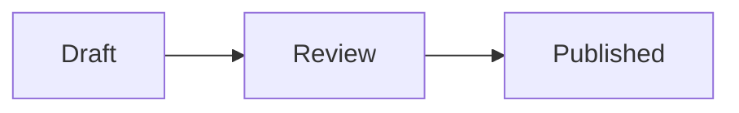

# Markdown compatibility

Onyx renders Markdown close to the current GitHub.com experience, with a small
set of Onyx-only note-taking extensions kept separate from GitHub behavior.
This is not a claim of perfect GitHub compatibility; differences are noted
below and covered by `src/lib/github-markdown-compat.test.ts`,
`src/lib/gfm-fixtures.test.ts`, and `src/lib/github-compare.test.ts`.

## Architecture

```text
Markdown source
→ remark parser (CommonMark/GFM + GitHub/Onyx extensions)
→ remark-rehype with raw HTML → rehype-raw
→ heading slugs and generated markup
→ rehype-sanitize (narrow allowlist)
→ syntax highlighting, math typesetting, link resolution, Pele SVG diagrams
→ renderer → preview styles
```

`src/lib/markdown-lite.ts` is a temporary first-paint and active-typing
renderer. It keeps the preview responsive while text is changing, then the
full renderer replaces it once input settles. It is not a second GitHub
Markdown implementation (`src/routes/page-controller.svelte.ts` always loads
the full renderer).

## 1. CommonMark/GFM — supported

Headings (ATX/Setext), emphasis, strong emphasis, `~~strikethrough~~`
(including GitHub single-tilde behavior), ordered/unordered/nested lists, task
lists, blockquotes, thematic breaks, fenced/indented code, inline code,
tables, autolinks, explicit/reference/collapsed/shortcut links, footnotes,
hard breaks (two-space and backslash; single newlines do not break).

## 2. GitHub writing features — supported

- Alerts: `NOTE`, `TIP`, `IMPORTANT`, `WARNING`, `CAUTION` only. The marker
  must start the blockquote; trailing marker-line text folds into the body
  (no custom titles); nested alerts stay plain blockquotes.
- Raw HTML: parsed then sanitized. `sub`, `sup`, `ins`, `details`, `summary`,
  and safe anchors pass; scripts, event handlers, `javascript:` URLs, and
  style attributes are stripped.
- Math: `$…$`, `$$…$$`, ````math`fences, and the alternate`$`…`$` inline
  syntax (KaTeX output; GitHub uses a different engine).
- Diagrams: `mermaid` fences render as SVG with Pele; `geojson`, `topojson`,
  and `stl` fences show a structural summary plus source instead of GitHub's
  interactive viewers.
- Heading anchors use `github-slugger` (via `rehype-slug`) with a
  `user-content-` prefix; `#section` links are re-pointed after sanitizing.
- Emoji shortcodes (`:tada:`) via `remark-gemoji`.

### Mermaid diagrams

Use a fenced block with the `mermaid` language:

````markdown

````

[Pele](https://pele.run/) renders all 33 built-in Mermaid diagram families.
Onyx renders static SVG in its Markdown worker, then enhances the preview with
container-aware layout, measured fonts, and zoom. Changing color themes updates
diagram colors immediately. Changing fonts or resizing a pane updates the layout.
For diagrams too wide to read at their fitted size, use the zoom buttons, pinch,
Ctrl/Command + wheel, or focus the diagram and press `+`, `-`, and `0` to zoom/reset.
Arrow keys pan a zoomed diagram; ordinary wheel scrolling still scrolls the note.

HTML exports and the PDF print view include static diagrams without requiring a
script, CDN, or network connection. Markdown, plain text, and RTF downloads retain
the source. Clipboard rich text includes SVG; display depends on the receiving app.
Preview images are disabled to preserve Onyx's image privacy policy; HTML exports
allow Pele's safe image URLs. URL links work, including relative Markdown note links.

[Pele's compatibility differences](https://pele.run/compatibility) still apply:
layout differs from Mermaid.js, arbitrary HTML labels and JavaScript callbacks
are not supported, external plugins such as ZenUML are unavailable, and Onyx does
not supply custom icon or math resolvers (math labels retain their TeX source).
Pele's default limits remain in place: 50,000 source characters, 4,000,000 SVG
characters, and 5,000 edges in flowcharts/agentflow. Invalid, unsupported, or
oversized diagrams show an escaped error and the original source while the rest
of the note continues rendering.

`src/lib/mermaid.test.ts` covers every built-in family, aliases, source preservation,
accessibility, error isolation, safe URLs, and exports. `test/e2e/mermaid.e2e.ts`
checks the actual worker and browser behavior, mobile zoom, fonts, every color
theme in light/dark modes, CSP, note links, offline editing, and print/HTML output.

## 3. Onyx-only extensions — intentionally different

- `[[wiki links]]` (with `#heading`, `|label`, and `!embed` forms). Links get a relative
  `.md` href; embeds do not.
- Inline `#tags`, rendered as links outside code and other links. A tag needs a non-digit, so
  `#42` stays text.
- `==highlight==` marks.
- Non-GitHub callout kinds (e.g. `[!TODO]`); rendered with an extra
  `onyx-callout` class to stay distinguishable from GitHub alerts.

Pass `{ dialect: "github" }` in `MarkdownRenderOptions` to disable the
Onyx-only layer; the default `"onyx"` dialect preserves the product
experience. There is no user-facing dialect setting.

## Comparing against GitHub

Run the live comparison harness explicitly (never in the normal suite):

```sh
GITHUB_MARKDOWN_COMPARE=1 \
GITHUB_MARKDOWN_TEXT='$(cat path/to/fixture.md)' \
GITHUB_TOKEN=ghp_optional \
vp test run src/lib/github-compare.test.ts
```

Output is normalized before comparison, so GitHub-only classes and Onyx-only
extensions show up as structural diffs, not failures.
